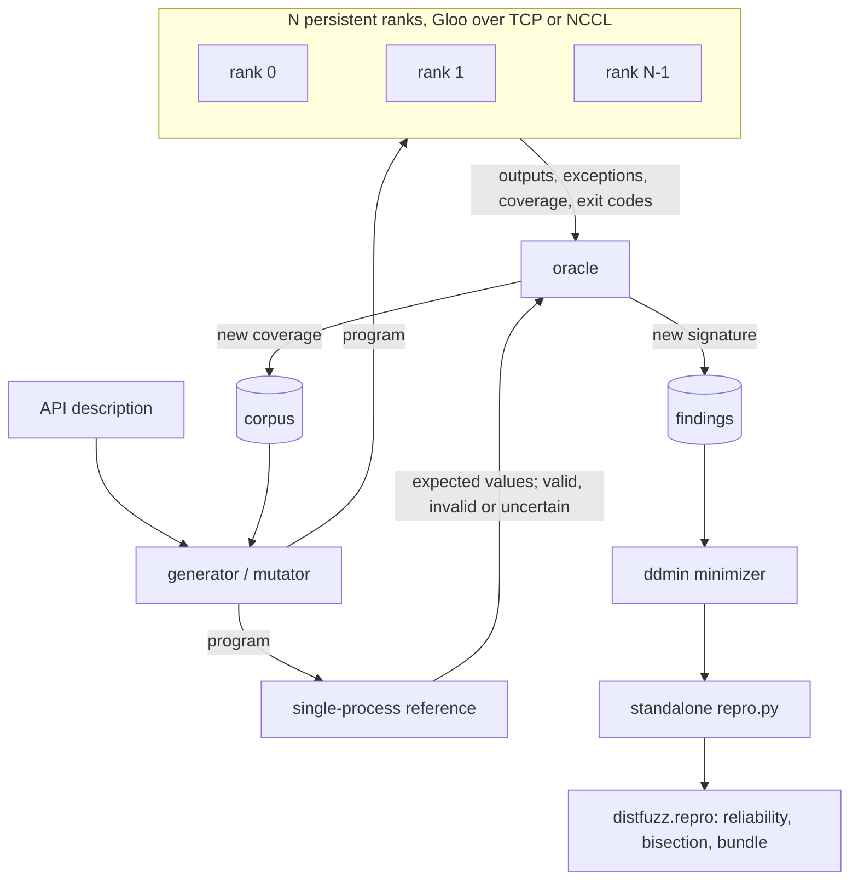
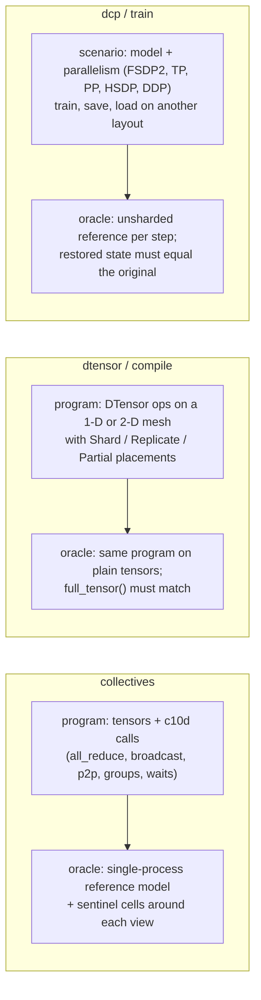
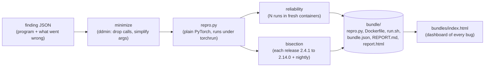

# Architecture

This page is for people who want to change distfuzz or compare it with other fuzzers. To use it, start with the [README](https://github.com/Temilola23/distfuzz#readme) or the [worked examples](examples/index.md).

## Components

Every fuzzer is differential. It runs the same program through the distributed API and through a single-process reference, then reports any difference.

| Package | Target | Oracle |
|---|---|---|
| `distfuzz.collectives` | c10d collectives and point-to-point calls on Gloo (CPU) or NCCL (CUDA), with per-rank divergence and uneven shapes | A single-process model of all ranks predicts every tensor on every rank. Sentinel cells around each buffer catch writes outside a view. Also: crash, hang, error on a valid program, silent acceptance of an invalid one. `--cross-backend` runs each program on a second backend and reports where the two disagree. |
| `distfuzz.collectives --fault` | Lifecycle and fault ops on top of the above: drop a `Work` before `wait()`, wait twice, destroy or abort a group, resize or free a tensor while an async collective uses it, SIGKILL a rank mid-collective | Crash and hang oracles only. A rank the program kills on purpose is expected to die; a surviving rank that dies with SIGSEGV or SIGABRT is a finding. Gloo only. |
| `distfuzz.dtensor` | DTensor ops (more than 540 of the 632 aten ops with a sharding strategy on torch 2.14), Shard, Replicate and Partial placements on 1-D and 2-D meshes, autograd | `full_tensor()` must equal the same program on plain tensors; also shapes, local shard shapes, gradients, and whether all ranks raise the same error. A per-rank watchdog names each hang by where the ranks are stuck. |
| `distfuzz.compile` | `torch.compile` (aot_eager, inductor) over DTensor programs and over small FSDP2, TP and FSDP2+TP models | Each program runs four ways: plain eager, DTensor eager, plain compiled, DTensor compiled. A finding is a difference that only the compiled DTensor run shows. |
| `distfuzz.dcp` | `torch.distributed.checkpoint` save and load, `get_state_dict` and `set_state_dict`, across FSDP2, TP, HSDP, DDP and 2-D meshes | Checkpoints are reloaded into a poisoned model under a different world size and parallelism; loaded state must match saved state bitwise, and training must match an unsharded reference. |
| `distfuzz.dcp --profile train` | Whole training steps built from production templates (torchtitan, torchtune, Hugging Face, accelerate, Lightning): forward, backward, clipping, optimizer step, accumulation, pipeline schedules, checkpoint and resume on a different layout | The same single-process reference per step (loss, gradient norm, parameters, optimizer state), plus hang location per rank, errors on some ranks only, and checkpoint round trips. |
| `distfuzz.repro` | Any finding or repro script | syzbot-style bundle: reliability over N fresh containers, bisection across releases 2.4.1 to 2.14.0 and a pinned nightly, pinned Dockerfile, report, dashboard. |

## The loop

The loop is the same for every fuzzer. The collectives fuzzer is shown. The DTensor, compile and DCP fuzzers replace the reference model with a plain-tensor or unsharded run of the same program on the ranks themselves.



### What each fuzzer generates and checks



### From a finding to a report



## How it maps to syzkaller

The design follows [syzkaller](https://github.com/google/syzkaller): programs are generated from typed API descriptions, run on a persistent set of worker processes, judged by oracles, deduplicated, minimized and turned into standalone repros.

| syzkaller | distfuzz | Gap |
|---|---|---|
| syzlang descriptions, typed resources | `collectives/desc.py` (resources `tensor`, `group`, `work`, `list`); `dtensor/gen.py` op templates; `dcp/templates.py` training templates with their source lines in each production stack | A Python table, not a language; no extraction from docs or OpInfo |
| `prog/` generation and mutation | `prog.py`, `gen.py`: insert, remove, mutate argument, splice, plus `diverge` (one rank skips or changes a call) | No learned choice table (`prog/prio.go`) |
| executor with fork server | Persistent rank processes, fresh process group per program, restart on hang or crash; about 17 times faster than a fresh world per program | One session at a time |
| kcov coverage | `sys.monitoring` line coverage of `torch/distributed`; with `--signal cxx`, SanitizerCoverage edge counters in Gloo and c10d from an instrumented build (`docker/Dockerfile.cov`) | C++ coverage needs a 1 to 2 hour source build |
| KASAN | Sentinel-cell oracle; differential reference models | No sanitizer build of Gloo or c10d |
| `pkg/repro`, `pkg/bisect`, syzbot dashboard | ddmin minimizers, `distfuzz.repro` (reliability, release bisection, static dashboard) | Release-level bisection only, no commit bisection |

## Key terms

| Term | Meaning here |
|---|---|
| Rank | One process in a distributed job. A run with world size 4 has ranks 0 to 3. |
| Collective | A call every rank makes together, such as `all_reduce` (every rank contributes a tensor and gets back the sum). |
| Gloo, NCCL | PyTorch's CPU and GPU backends for collectives. |
| Process group | The set of ranks a collective runs over. `new_group` and `new_subgroups` create smaller ones. |
| DTensor | A tensor split across ranks. Placements say how: `Shard(d)` splits dim `d`, `Replicate()` copies it, `Partial(op)` holds unreduced pieces. |
| DCP | `torch.distributed.checkpoint`: saves a sharded model and loads it back, possibly onto a different layout. |
| Program | A short list of API calls, run on every rank, that the fuzzer generates and executes. Stored as JSON. |
| Scenario | The DCP and training equivalent of a program: a model, a parallelism plan per segment, training steps, and the checkpoints between segments. |
| Oracle | What decides whether a result is wrong. Here, an independent computation of the correct answer. |
| Finding | Anything the oracle flags: a wrong value, a hang, a crash, a rank desync, an unexpected error. Saved as JSON with its program. |
| Signature | A short key that groups findings of the same kind, for example `WRONG_RESULT\|all_reduce\|torch.int64`. |
| Corpus | Programs kept because they reached new code. Guided mode mutates them; random mode does not keep any. |
| Minimize | Shrink a failing program, with delta debugging, to the fewest calls that still fail. |
| Repro | A standalone PyTorch script that shows one bug. |
| Bundle | A folder per bug with a plain PyTorch repro, a pinned Dockerfile, a reliability result and a per-release bisection table. |

## C++ coverage

`docker/Dockerfile.cov` builds PyTorch v2.14.0 from source with clang and SanitizerCoverage in Gloo and c10d only (128,324 edges; about 20 GB of memory and 1 to 2 hours to build). `--signal cxx` reads the counters in every rank. In guided mode a program with new C++ features is re-run twice; features a re-run does not reproduce are dropped and ignored from then on, and the program is shrunk to the calls the new features need before it enters the corpus.

```bash
docker build -f docker/Dockerfile.cov -t distfuzz:cov .
docker run --rm --memory 3g --cpus 4 --shm-size 1g -v "$PWD/runs:/src/runs" distfuzz:cov \
  python -m distfuzz.collectives fuzz --mode guided --signal cxx --minutes 10 --out runs/cxx
```

## Status and limitations

distfuzz is a capstone research prototype. What holds up:

- The oracles. The collectives reference model is checked cell by cell against real Gloo by more than a hundred multi-rank tests, and the sentinel oracle turns "wrong result" into "writes outside the view".
- Findings minimize to a few calls and reproduce deterministically.
- Making a quarter of generated programs rank-divergent finds more distinct failures than plain random generation (89 to 92 against 75 to 79 on five 2-hour seeds, silent accepts left out).

What does not, yet:

- Coverage guidance does not beat random generation. Python line coverage saturates within minutes and cannot see the C++ where the Gloo bugs live. With C++ coverage, random generation still reached more stable edges in a 5-seed, 10-minute comparison.
- A single-op property test of about 250 lines rediscovers several of the headline DTensor bugs. The multi-call program machinery matters most for rank divergence, checkpoints and training steps.
- The collectives fuzz loop does not reload its corpus between runs. `distfuzz.repro` measures reliability after the fact.
- `minimize`, `replay`, `campaign` and `bench` in the collectives fuzzer run on Gloo only. NCCL findings are reproduced by hand.
- Campaigns so far ran 5 minutes to 8 hours on 3 to 6 CPUs, and about 3 hours on two T4 GPUs.

[BACKLOG.md](https://github.com/Temilola23/distfuzz/blob/main/BACKLOG.md) has the roadmap in priority order.

## Repository layout

```
distfuzz/
├── src/distfuzz/
│   ├── collectives/   c10d fuzzer: desc.py (API descriptions), prog.py (generator, mutator),
│   │                  tensors.py (inputs with sentinel cells), reference.py (single-process model),
│   │                  executor.py (persistent ranks), oracle.py, fuzzer.py, minimize.py, replay.py,
│   │                  faults.py (--fault ops), cxxcov.py (--signal cxx), campaign.py
│   ├── dtensor/       DTensor fuzzer: gen.py (op templates), worker.py, world.py, hang.py (watchdog),
│   │                  fuzz.py, minimize.py, report.py
│   ├── compile/       torch.compile fuzzer: prog.py, module.py (FSDP2/TP models), worker.py,
│   │                  fuzz.py, minimize.py, repro.py
│   ├── dcp/           checkpoint and training fuzzer: gen.py (classic scenarios), train_gen.py and
│   │                  templates.py (training profile), blocks.py (LoRA, MoE, clip variants),
│   │                  known.py (known-bug predictor), runtime.py, world.py, fuzz.py, minimize.py,
│   │                  standalone.py, report.py
│   └── repro/         bundles: reliability, release bisection, reports, dashboard
├── tests/             host tests; multi-rank tests are marked `multirank` and run in Docker
├── examples/
│   ├── repros/        plain PyTorch scripts, one or more per bug
│   ├── programs/      the fuzzer programs behind the repro bundles
│   ├── kaggle/        notebook for two-GPU runs on Kaggle
│   └── repro_specs.json
├── docs/              this site (MkDocs)
├── docker/            Dockerfile.cov (C++ coverage build), Dockerfile.cc (adds g++ for inductor)
├── Dockerfile, Makefile
├── BACKLOG.md, CHANGELOG.md, CONTRIBUTING.md
```
